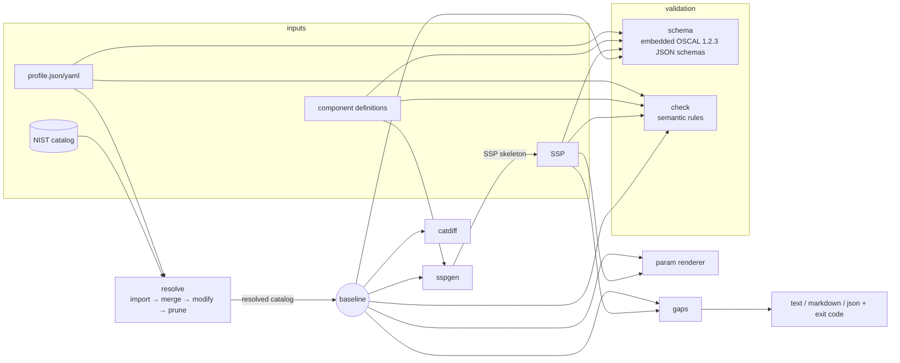

# oscalkit

[](https://github.com/guneshm03/oscalkit/actions/workflows/ci.yml)

A Go toolkit and CLI for [NIST OSCAL](https://pages.nist.gov/OSCAL/) compliance-as-code. It loads
catalogs, profiles, component definitions and System Security Plans (SSPs). It resolves profiles
following the NIST profile-resolution specification, substitutes parameters, generates SSP
skeletons from component definitions, validates documents against the official OSCAL JSON
schemas plus referential-integrity rules, and reports control gaps in an SSP against its resolved
baseline.

```
oscalkit resolve | validate | gaps | generate | render | compare
```

**Conformance result:** oscalkit resolves the four official NIST SP 800-53 rev5 baseline profiles
(LOW, MODERATE, HIGH, PRIVACY) from the pinned official catalog. The output matches NIST's own
published resolved catalogs in control set, order, nesting, per-control content, groups and pruned
back-matter. Command: `go test ./resolve -run TestNISTBaselines -v`.

## Why

An authorization package built with OSCAL usually goes through these steps:

1. Pick a baseline, which is a *profile* such as NIST MODERATE.
2. Tailor it with another profile (drop inherited controls, add some, set organization-defined
   parameters).
3. Resolve the tailored profile into a concrete catalog.
4. Describe how the system's *components* implement each control.
5. Assemble those descriptions into an SSP.
6. Check the SSP for missing controls and unfinished work.

Each step is easy to get subtly wrong by hand. For example, an enhancement selected without its
parent has to end up in the right place, and back-matter that no control references has to be
pruned. oscalkit does these steps in one static binary, offline, and checks itself against NIST's
reference output.

**Who it's for:** GRC and compliance engineers who keep SSPs in git, platform and security teams
who want CI gates on compliance artifacts, and OSCAL tool authors who need a second resolver to
diff against.

## Features

| Area | What it does |
|---|---|
| Model + IO | Typed Go structs for catalog, profile, component-definition and SSP in canonical field order. JSON, YAML and gzip input. Lossless round trip, proven on the full NIST catalog (`oscal/roundtrip_test.go`). |
| Profile resolution | Import phase: `include-all`, `with-ids`, glob `matching`, `with-child-controls`, `exclude-controls` (exclusion wins), nested profile imports, `#uuid` back-matter imports (rlink JSON/YAML or base64), cycle detection with the full chain in the error, depth limit. Merge phase: `combine` `use-first` / `keep`; structuring `flat` / `as-is` (with up-levelling) / `custom` (groups, `insert-controls`, `order`). Modify phase: `set-parameters` and `alters` with `adds` (implicit and `by-id`, at all four positions, including nested parts and child controls) and `removes` (`by-id/name/class/ns/item-name`). Final operations: metadata, combined back-matter with `keep=always`, pruning of unreferenced resources and loose params. |
| Parameter substitution | Renders `{{ insert: param, id }}` with values, selections (`[Selection (one or more): ...]`), assignments (`[Assignment: ...]`), SP 800-53 `aggregates` params, and legacy `alt-identifier` ids such as `ac-1_prm_2`. |
| Validation | Official OSCAL 1.2.3 JSON schemas are embedded, and violations are reported as JSON Pointers. Semantic checks cover what the schema cannot express: duplicate ids/uuids, dangling `#` links and param inserts, unknown roles/parties/components, statement/control mismatches, invalid implementation states. |
| SSP generation | Builds a schema-valid SSP from component definitions. Each baseline control gets an implemented-requirement with one by-component per contributing component (a component's repeated claims for a control are merged), plus statements, parameter values and roles. The output is self-checked against the schema and the semantic checks before it is written. Uncovered controls become `planned` placeholders. `--seed` makes output reproducible. |
| Gap analysis | Finds missing controls, planned/partial/unspecified status, unjustified not-applicable, unset parameters, uncovered statement items, unknown statements/components/parameters, controls outside the baseline and withdrawn controls. Reports a per-family summary in text, Markdown or JSON, with a `--fail-on` exit code for CI. |
| Compare | Diffs two catalogs or profiles: control set, order, placement, normalized content, groups and back-matter. |

## Architecture



| Package | Role |
|---|---|
| `oscal` | Models, JSON/YAML/gzip loading, canonical encoding, UUID generators (random v4 or seeded v5) |
| `schema` | Embedded official JSON schemas with violation flattening (picks the best `anyOf` branch) |
| `resolve` | The profile resolver (`resolver.go`, `select.go`, `merge.go`, `modify.go`, `prune.go`, `fetch.go`) |
| `param` | Insert parsing, parameter substitution and statement rendering |
| `check` | Semantic validation |
| `catdiff` | Catalog comparison |
| `sspgen` | SSP skeleton generation |
| `gaps` | SSP-versus-baseline gap analysis |
| `internal/cli` | The `oscalkit` command |

See [docs/ARCHITECTURE.md](docs/ARCHITECTURE.md) for the algorithms and their complexity.

## Quickstart

Requires Go 1.25+.

```sh
make build                       # -> bin/oscalkit
make check                       # gofmt + vet + golangci-lint + race tests + coverage gate
make demo                        # offline end-to-end run on bundled fixtures

bin/oscalkit resolve testdata/oscal-content/nist.gov/SP800-53/rev5/json/NIST_SP-800-53_rev5_HIGH-baseline_profile.json -o high.json
bin/oscalkit validate high.json
bin/oscalkit generate --profile examples/profiles/acme-low-tailored_profile.json \
  --component examples/components/acme-sso_component.json --system-name "My System" -o ssp.json
bin/oscalkit gaps ssp.json --format markdown          # baseline taken from the SSP's import-profile
bin/oscalkit render --baseline high.json ac-2 --set ac-02_odp.10=quarterly
```

Exit codes: `0` success, `1` findings (validation errors, or gaps at or above `--fail-on`), `2`
usage or I/O errors. Imports over `http(s)` are refused unless you pass `--allow-remote`.

## Demo

Output of `make demo`, copied from a real run (abridged where marked). The "Acme" profile and
components are synthetic examples written for this repo. The NIST files are the official ones.

```
== 1. Resolve the official NIST MODERATE baseline and compare it with NIST's own resolution
resolved "Electronic (OSCAL) Version of NIST Special Publication 800-53 Revision 5.2.0 MODERATE IMPACT BASELINE": 287 controls in 18 groups, 0 loose params, 147 back-matter resources (2 source documents)
A: out/moderate-resolved.json (287 controls)
B: testdata/oscal-content/nist.gov/SP800-53/rev5/json/NIST_SP-800-53_rev5_MODERATE-baseline-resolved-profile_catalog.json (287 controls)
identical: same controls, order, nesting, content, groups and back-matter

== 3. Resolve the tailored profile (imports the NIST LOW profile, excludes PE-*, adds 4 MODERATE controls, sets params, alters AC-2/AC-11)
resolved "Acme Cloud LOW+ Tailored Baseline": 143 controls in 17 groups, 0 loose params, 136 back-matter resources (3 source documents)
out/acme-baseline.json: catalog valid (0 schema violations, 0 semantic errors, 0 warnings)

== 4. What did tailoring change relative to the NIST LOW baseline?
A: out/acme-baseline.json (143 controls)
B: testdata/oscal-content/nist.gov/SP800-53/rev5/json/NIST_SP-800-53_rev5_LOW-baseline-resolved-profile_catalog.json (149 controls)
only in A (4): ac-6, ac-11, sc-8, sc-28
only in B (10): pe-1, pe-2, pe-3, pe-6, pe-8, pe-12, pe-13, pe-14, pe-15, pe-16
content differs (2): ac-1, ac-2
groups only in B (1): pe
resources only in A (1): 7537638e-2837-407d-844b-40fb3fafdd99

== 5. Generate an SSP skeleton from the four component definitions
generated SSP "System Security Plan: Acme Customer Portal": 143 baseline controls, 39 addressed by 4 components, 104 uncovered
out/acme-ssp.json: system-security-plan valid (0 schema violations, 0 semantic errors, 0 warnings)

== 6. Gap analysis of the generated SSP against its resolved baseline
Gap analysis: System Security Plan: Acme Customer Portal
Baseline:     Acme Cloud LOW+ Tailored Baseline
Controls:     143 in baseline, 143 addressed, 28 satisfied (19.6%)
Status:       implemented 36, partial 2, planned 105
Gaps:         0 error, 286 warning, 0 info

FAMILY TITLE                                        SATISFIED  MISSING
AC     Access Control                                    3/13        0
AU     Audit and Accountability                          6/10        0
IA     Identification and Authentication                 4/16        0
...                                                      (abridged)
WARNING  ac-2       uncovered-statement         statement item ac-2_smt.c is not addressed
WARNING  ac-2       unset-parameter             parameter ac-02_odp.02 (attributes (as required)) has no value
WARNING  ac-3       status-planned              implementation is planned, not in place

== 7. Parameter substitution: AC-7 and AC-11 rendered with the SSP's values
## AC-7 Unsuccessful Logon Attempts

- a. Enforce a limit of 5 consecutive invalid logon attempts by a user during a 15 minutes ; and
- b. Automatically lock the account or node until released by an administrator when the maximum number of unsuccessful attempts is exceeded.

== 8. A hand-edited draft SSP with deliberate mistakes: validation and gaps catch them
examples/ssp/acme-ssp-draft.json: system-security-plan INVALID (0 schema violations, 2 semantic errors, 0 warnings)
  error    unknown-component /system-security-plan/control-implementation/implemented-requirements/2/by-components/0: by-component references component 5837e974-01b9-4543-9738-a09475dd6106, which is not in system-implementation
  error    unknown-role /system-security-plan/control-implementation/implemented-requirements/4: responsible-role references undefined role "identity-admin"
Controls:     143 in baseline, 6 addressed, 2 satisfied (1.4%)
Gaps:         140 error, 30 warning, 0 info
ERROR    ac-2       unknown-statement           statement "ac-2_smt.z" is not a part of ac-2
ERROR    ac-3       missing-control             baseline control AC-3 (Access Enforcement) has no implemented-requirement
ERROR    ac-7       unknown-component           by-component references unknown component 5837e974-01b9-4543-9738-a09475dd6106
```

The AC-7 line keeps NIST's own spacing ("a 15 minutes ;"): oscalkit substitutes values into the
official prose without rewording it.

## Evaluation and numbers

Every number below comes from the command shown next to it, run on macOS arm64 (8 cores).

| Measure | Result | Command |
|---|---|---|
| NIST rev5 baselines resolved identically to NIST's published resolved catalogs | 4 / 4 (LOW 149, MODERATE 287, HIGH 370, PRIVACY 96 controls, plus 135/147/147/82 back-matter resources) | `go test ./resolve -run TestNISTBaselines -v` |
| Controls whose only difference from NIST's resolved catalogs is whitespace | 60 / 84 / 103 / 32 (LOW/MOD/HIGH/PRIVACY). Every one of them is byte-identical to the source catalog, so the whitespace was added by NIST's XSLT resolver. | `bin/oscalkit compare --exact --format json <profile> <nist-resolved>` and `bin/oscalkit compare --exact <HIGH profile> <catalog>` (0 changed) |
| NIST content with zero schema violations and zero semantic findings | 9 / 9 files | `go test ./check -run NIST` and `bin/oscalkit validate testdata/oscal-content/nist.gov/SP800-53/rev5/json/*.json*` |
| Resolve the HIGH baseline (read + gunzip the 11 MB catalog + resolve) | 94-138 ms/op, about 70 MB allocated/op (5 runs) | `make bench` |
| Core-package statement coverage | 96.0 % (gate: 80 %) | `make cover` |
| Per-package coverage | oscal 92.3, schema 93.3, resolve 94.9, param 99.3, check 98.3, catdiff 93.1, sspgen 100, gaps 96.2, cli 93.2 | `go test -cover ./...` |
| Size | 6,242 lines of non-test Go (5,221 excluding blanks and comments); 2,855 lines of tests (2,626 code lines) | `make loc` |

The spec-example tests are in `resolve/*_test.go`. They reproduce the specification's examples
(include-with-children, use-first, modify-adds, without-parent), and the modify-adds case is a
golden comparison against the spec's expected output. Fuzz targets: `FuzzGlobMatch` (checked
against a regexp oracle), `FuzzDecode` and `FuzzRender`. Run them with `make fuzz`. On its first
run, the glob fuzzer found a real bug: a literal `*` in a control id was consumed as a wildcard.
The bug is fixed, and the failing input is kept as a regression seed in
`resolve/testdata/fuzz/`.

## Design decisions

The main ones are below. All decisions, with the reasoning and the cost if they turn out wrong, are
in [DECISIONS.md](DECISIONS.md).

- **NIST's reference resolver is the arbiter where the draft spec contradicts itself.** The spec's
  prose says that including a control also includes its ancestors. NIST's published PRIVACY
  baseline does the opposite and up-levels `ac-3.14` without `ac-3`. oscalkit follows NIST's
  output by default and offers `--include-ancestors` for the prose behaviour.
- **The pinned upstream schemas are kept byte-identical and patched in memory.** The published
  OSCAL 1.2.3 profile JSON schema leaves out `merge.combine.method`, so every `use-first` profile
  would be rejected. oscalkit adds the missing property when it compiles the schema. A test
  documents the defect, and the embedded file still matches its checksum.
- **Values and selections replace each other** when `set-parameters` targets a parameter, because
  OSCAL's schema allows one or the other but not both.
- **Offline by default.** Remote imports need `--allow-remote`. A missing `x.json` falls back to
  `x.json.gz`, so the 11 MB catalog ships compressed (1.8 MB for all the NIST fixtures, measured with `du -sh testdata/oscal-content`).
- **Deterministic output on demand.** `--seed` switches every UUID to a seeded v5 UUID, and the
  timestamp is injectable, so generated SSPs can be diffed in code review.

## Limitations

- **XML is not supported.** Inputs are JSON or YAML. Back-matter rlinks that point only at XML
  cannot be followed.
- **The spec is still a draft.** Where the specification is silent or contradictory, oscalkit
  follows a documented decision (see DECISIONS.md), and another resolver may differ. Examples:
  ordering of `custom` inserts, merging of same-id groups across `as-is` imports, and `remove`
  matching links by `rel`. Only the four NIST baselines are checked against an external reference
  implementation. The other behaviours are checked against the spec text and examples, as
  interpreted from them.
- **Import `mapping` is not implemented.** It is absent from the OSCAL 1.2.3 JSON schema.
  Deprecated `combine: merge` is rejected rather than guessed at.
- **Semantic checks cover a subset of the metaschema constraints.** They do not evaluate
  metaschema allowed-values for every prop name, or any XPath-style constraint.
- **Gap analysis is structural.** It checks what an SSP *claims* (statuses, coverage, parameters),
  not whether the claims are true. It does not read assessment results or POA&Ms.
- **The SSP skeleton is a starting point.** System characteristics are `[Placeholder]` text, and
  component-definition claims are imported as `implemented` unless the component carries an
  `implementation-status` prop. Leveraged authorizations, inventory and users are not generated.
- **The resolver is single-threaded and fully in memory.** That is fine for SP 800-53 (about 0.1 s
  for HIGH) but not designed for multi-GB catalogs.

## Roadmap

- XML input via the OSCAL XMLJSON converters
- `import` `mapping` once it returns to the schema
- Assessment-plan/results awareness in `gaps` (assessed vs merely claimed)
- FedRAMP-specific checks (required props, `implementation-status` conventions)
- Profile diffing at the directive level ("which alter changed AC-2?")
- Verify back-matter rlink `hashes` when fetching imports

## Data and license

The NIST SP 800-53 rev5 OSCAL content (usnistgov/oscal-content `v1.6.0`) and the OSCAL 1.2.3 JSON
schemas are pinned with SHA-256 sums. Sources and terms are in [DATA.md](DATA.md), and
`make fetch-content` re-downloads and verifies them. The code is MIT licensed; see [LICENSE](LICENSE).

## Maintainer

Originally authored by Gunesh Mahajan; currently maintained by Gunesh Mahajan.

For project questions or maintenance inquiries, contact [Gunesh Mahajan](mailto:guneshmahajan574@gmail.com) or connect on [LinkedIn](https://www.linkedin.com/in/guneshm007/). You can also find the project on [GitHub](https://github.com/guneshm03/oscalkit).