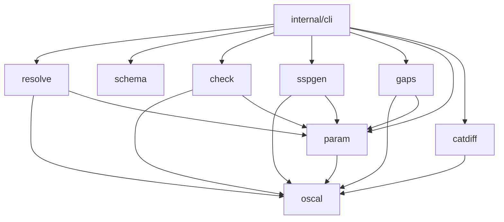

# Architecture

oscalkit is a set of small Go packages connected by one data model. The `oscalkit` binary
(`internal/cli`) is a thin layer over those packages. Each package can also be used as a library.

`schema` depends on nothing in the module. It works on raw JSON bytes, so a document that the
typed model cannot decode can still be schema-checked.

## 1. Data model (`oscal`)

- One Go struct per OSCAL assembly. Fields are declared in **canonical metaschema order**, so
  `encoding/json` writes them in that order. A few large, rarely inspected structures (revisions,
  locations, actions, protocols, inventory, export/inherited/satisfied, diagrams) are kept as
  `json.RawMessage` so they survive a round trip without being modelled.
- `TestRoundTripNIST` proves the model is lossless: the full NIST catalog, a profile and two
  resolved catalogs go through decode → encode, and the result must be value-equal to the original
  JSON.
- `Document` holds exactly one model plus the raw JSON (used for schema validation).
  `DetectModel` reads the root key. `Normalize` turns gzip and YAML input into JSON. YAML goes
  through `yaml.Node` so that timestamps and `yes`/`no` stay strings. Expansion is budgeted
  (20 M nodes) against alias bombs, and decompressed size is capped at 256 MiB.
- Catalog traversal: `WalkControls` is a depth-first, document-order walk that yields
  `ControlRef{Control, ParentID, GroupPath, Order}`. `ControlIndex`, `ControlIDs`, `Control` and
  `AllParams` are built on top of it. Every one is O(n) in the number of controls.
- `Clone` methods deep-copy controls, parts and params. The resolver never mutates source
  catalogs, because they may be cached and shared between imports.
- UUIDs come from `UUIDGen`: `RandomUUIDs` (RFC 4122 v4, `crypto/rand`) or `DeterministicUUIDs`
  (v5 over SHA-1 of namespace‖seed‖key). Reproducible builds use the second.

## 2. Profile resolution (`resolve`)

The resolver follows the three phases of the NIST specification, then its final operations.
`resolveProfile` is recursive: an import that points at a profile is itself resolved to a catalog
first.

### Import phase (`resolver.go`, `select.go`, `fetch.go`)

1. **Locate.** A plain href is resolved against the importing profile's absolute URI (RFC 3986
   reference resolution, `net/url`). A `#uuid` href is looked up in the profile's back-matter.
   rlinks are ranked JSON > YAML > other, and XML is skipped. If there is no usable rlink, the
   embedded `base64` content is decoded and given the synthetic URI `profile#uuid`.
2. **Cycle check.** The current import stack (a list of absolute URIs) is searched for the
   target. On a hit, the error shows the whole chain (`a.json -> b.json -> a.json`). Depth is
   limited by `MaxDepth`, 32 by default.
3. **Fetch and decode.** `Fetcher` is an interface: `FileFetcher` reads `file://` URIs (with a
   `.gz` fallback) and reads `http(s)` only when `AllowRemote` is set; `MapFetcher` serves tests.
   Decoded documents are cached by URI, and resolved sub-profiles are cached as well. A cached
   sub-profile cannot reach the current stack, because any path from it back to the stack would
   already have failed the cycle check when it was first resolved.
4. **Select.** `newHierarchy` records document order, parent and children for every control id.
   `selectSet` computes the included set:
   - `include-all` → every id;
   - `with-ids` and glob `matching` (`globMatch`: only `*` and `?`, iterative backtracking,
     O(|p|·|s|) worst case) → matched ids, plus descendants for `with-child-controls: yes`, plus
     ancestors only when `IncludeAncestors` is set;
   - `exclude-controls` → removed afterwards. Exclusion always wins.

   Selectors that match nothing produce warnings (`unknown-control`, `unmatched-pattern`,
   `empty-pattern`).

   Cost: O(n + Σ|selectors|·n) per import, where n is the number of controls in the imported
   catalog.

### Merge phase (`merge.go`)

- `mergeMode` validates the directive: at most one of flat, as-is or custom, and a combine method
  of `keep`, `use-first` or (rejected) `merge`.
- **use-first** runs before structuring. `applyUseFirst` walks the imports in order and removes
  from each import's selection any id that an earlier import already selected.
- **as-is**: `asIsControls` rebuilds the source nesting from the included set. An excluded control
  is replaced by its included descendants (up-levelling, applied recursively). `asIsGroups` keeps
  groups that contain something, or that are `keep=always`. Groups with the same id from
  different imports are merged.
- **flat**: included controls in document order, with nesting removed. Group params become
  catalog-level loose params.
- **custom**: the "pool" is the flat list of all included controls. A hierarchy is rebuilt over
  the pool so that `with-child-controls` still works, using the nearest *included* ancestor. Each
  `insert-controls` reruns `selectSet` against the pool hierarchy (without ancestors) and emits the
  selected controls in pool order, or sorted ascending/descending by id. A custom group that shares
  an id with an included source group inherits that group's params, props, links and parts.

Cost: O(n) per import for as-is and flat. Same-id group merging is O(g²) in the number of groups,
which is at most 20 for SP 800-53.

### Modify phase (`modify.go`)

- **set-parameters**: `paramsByID` finds every parameter with the id, wherever it lives (loose,
  group, control, child control). Scalars are replaced, and `values` and `select` replace each
  other. Props are appended (a uuid replaces a prop with the same uuid). Links are de-duplicated.
  Constraints and guidelines are appended. An unknown id produces a warning, and processing
  continues.
- **alters**: `controlsByID` finds every control with the id. Removes run first. `removeMatches`
  is a conjunction of the given criteria, applied recursively through params and parts but not
  into child controls. Then adds run:
  - no `by-id`, or `by-id` equal to the control's own id → implicit binding. `starting`/`before`
    prepend and `ending`/`after` append to each typed list, and `title` replaces the control's
    title.
  - otherwise `findInControl` locates the target. It may be a param, a part (at any depth) or a
    child control (recursively). `starting`/`ending` add *inside* the target. `before`/`after`
    insert same-kind objects next to the target (`slices.Insert`) and place other kinds at the
    start or end of the container's lists. Placements the schema forbids produce an `invalid-add`
    warning instead.

Cost: each directive is O(n) to find its targets, so the phase is O(d·n) for d directives.

### Final operations (`resolver.go`, `prune.go`)

- **Metadata**: taken from the profile, with a fresh `last-modified`, the `oscal-version` rule
  (newest input minor, capped at 1.2.3, mixed majors are an error), `resolution-tool` and
  `source-profile` props, a `source-profile` link, and the `keep=always` roles and parties from
  the sources.
- **Back-matter**: `combineBackMatter` concatenates the imports' back-matter in import order and
  then the profile's own. A later resource with the same uuid replaces the earlier one and moves to
  the later position, unless the earlier one is `keep=always` and the later one is not.
- **Pruning** is a reachability fixpoint. The surviving catalog (without loose params and
  back-matter) is marshalled once and scanned in one pass for `#token` fragments, insert
  directives and `aggregates` props. Loose params and resources that are referenced (or
  `keep=always`, or named by set-parameters) are kept, and *their* content is scanned in turn,
  until nothing changes. Cost: O(S + k·s), where S is the size of the catalog's JSON and k·s is the
  total size of the kept objects.
- **Duplicate check**: under `keep`, a clashing control id produces a `duplicate-control`
  warning.

### Conformance

`TestNISTBaselines` resolves the LOW, MODERATE, HIGH and PRIVACY profiles against the pinned
catalog and runs `catdiff.Compare` against NIST's resolved catalogs. The test requires the same
control set, the same document order, the same parent or group placement for every control, equal
normalized content for every control and group, and the same back-matter resource list. All four
match. With `--exact`, the only remaining differences are whitespace that NIST's XSLT pipeline
adds to prose. oscalkit's output is byte-identical to the source catalog's controls.

## 3. Parameter substitution (`param`)

- `FindInserts` uses one regexp for `{{ insert: <type>, <id> }}`. Only `param` inserts are
  substituted.
- `Renderer` indexes every param in the catalog, plus aliases taken from `alt-identifier` props.
  The aliases let SSPs written against older SP 800-53 content (`ac-1_prm_2`) target the current
  ids (`ac-01_odp.03`). Overrides (SSP or command-line values) take priority over catalog values.
- `Text(id)` follows these rules in order: effective values, rendered recursively because a value
  may be a choice that contains an insert → an `aggregates` param whose parts are all set → a
  selection → an assignment label. Recursion is capped at depth 8, so a self-referential label
  terminates as `[...]`.
- `Statement` walks the statement part depth-first into `Line{Depth, Label, Text}`, and
  `FormatMarkdown` prints those lines as a nested list.

## 4. Validation

- **Schema** (`schema`): the four official JSON schemas are compiled lazily, once per process,
  with `santhosh-tekuri/jsonschema/v6` (draft-07, RE2-compatible patterns). The profile schema is
  patched in memory first (see DECISIONS.md). `flatten` reduces the error tree to leaf violations.
  For `anyOf`/`oneOf` it descends only into the branch that reaches deepest into the instance, so
  a bad param reports the actual bad field rather than "does not match anyOf".
- **Semantics** (`check`): a model-independent pass over the raw JSON finds duplicate `uuid`
  definitions and collects `#fragment` links. Model-specific passes then check:
  - catalogs: unique ids across controls, groups, params and parts; param inserts resolve; links
    resolve;
  - profiles: back-matter imports exist; structuring directives; add positions; repeated alters;
  - component definitions: roles, empty implementations, duplicate requirements, statement
    ownership;
  - SSPs: component, role and user references; implementation-state values; a `this-system`
    component exists.

  Each finding has a severity, a code and a JSON-Pointer-style path.

## 5. SSP generation (`sspgen`)

1. Build `system-implementation`: a `this-system` component, plus one system component per
   defined component (the uuid is reused, and a clash gets a new uuid and a warning).
2. Index the contributions as `control-id → [(component, claims)]`, where a claim is one
   implemented-requirement with its control-implementation's set-params and `source`. A component
   that claims the same control more than once (in several control-implementations, e.g. one per
   baseline revision) gets a single contribution holding all of its claims, and a
   `merged-implementations` warning. Contributions for controls outside the baseline produce
   `not-in-baseline` warnings. `source` is not used to filter claims (see DECISIONS.md).
3. Walk the baseline in document order, skipping withdrawn controls. A covered control gets one
   by-component per (control, component) pair, with:
   - the distinct descriptions of the component's claims, joined by blank lines;
   - the status from the `implementation-status` prop, `implemented` by default; when the
     component's claims disagree, the least complete status wins (`conflicting-status` warning);
   - parameters canonicalized through the renderer, with requirement-level values overriding
     CI-level values within a claim, and the first claim (then the first component) winning
     otherwise (a conflict produces a `conflicting-param` warning);
   - statements merged by statement id, one statement by-component per component, merged the same
     way (unknown ids produce warnings);
   - responsible roles unioned by role id, without party references.

   Generated uuids are derived from (control, component) and (statement, component), which are
   unique after merging; a component uuid repeated across inputs is replaced by a fresh one.
   An uncovered control gets a planned placeholder attributed to `this-system`.
4. Collect the metadata roles from every responsible role used. Fill system characteristics with
   `[Placeholder]` text and the optional FIPS-199 level.

The CLI self-checks the result against the SSP schema and the semantic checks of `check` (unique
uuids, resolvable references, allowed states) before writing it; a failure writes nothing. Generation is O(n + c),
where c is the number of component requirements.

## 6. Gap analysis (`gaps`)

For each non-withdrawn baseline control, in document order:

1. Gather its implemented-requirements (duplicates are analysed together and produce a warning).
2. Collect every by-component status (control level and statement level) and take the **worst**,
   ranked implemented < not-applicable < alternative < unspecified < partial < planned < missing.
   A mix of not-applicable and implemented counts as implemented.
3. Emit gaps:
   - missing requirement or no descriptions → error;
   - unknown component, unknown statement or unknown parameter → error;
   - planned, partial or unspecified status → warning; alternative → info;
   - not-applicable with neither a justification nor a real description → warning;
   - when statements are used, top-level statement items not addressed (directly, via a parent,
     or via a sub-item) → warning;
   - parameters referenced by the statement with no effective value → warning. Effective values
     combine the baseline values, the SSP's global set-parameters, the by-component values and the
     requirement values, and are alias-aware. An aggregate param counts as set when all its parts
     are set.
4. A control is *satisfied* when its status is implemented, not-applicable or alternative and none
   of its gaps is warning-level or worse.

SSP requirements for controls that are not in the baseline (`not-in-baseline`), or that are
withdrawn in it, produce warnings. The summary rolls up by top-level group (family). Cost:
O(n + r + p), where r is the number of requirements and p the number of parameter references. One
renderer is built per addressed control, so the worst case is O(n·P) for P catalog params.

## 7. Error handling and logging

- Library functions return wrapped errors with sentinel roots (`ErrCircularImport`,
  `ErrBadImport`, `ErrNoImports`, `ErrMergeDirective`, `ErrVersionMismatch`, `ErrRemoteDisabled`,
  `oscal.ErrUnknownModel`) for `errors.Is`.
- Non-fatal conditions that the specification marks "SHOULD warn" are returned as structured
  `Diagnostic{Code, Message}` values, never printed by the library. The resolver also emits them
  to an injectable `*slog.Logger` at debug level (`oscalkit -v`).
- The CLI maps outcomes to exit codes: 0 OK, 1 findings, 2 usage or I/O errors.
